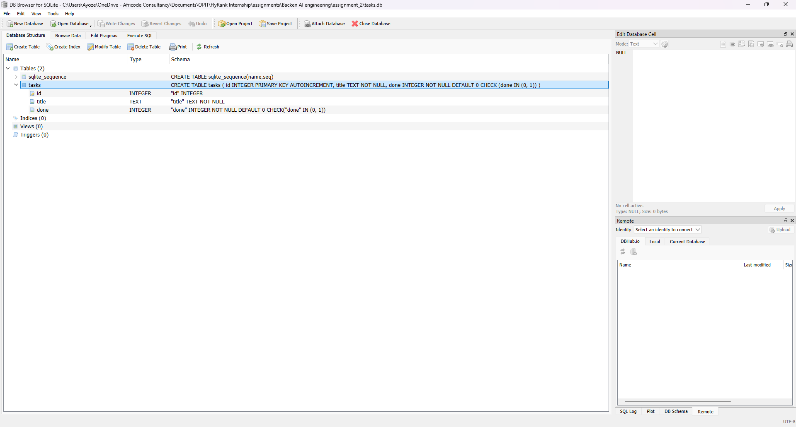

# Assignment 2: Connecting CRUD to the Database

## 1. Project Overview

This project is part of the FlyRank AI Engineering Internship Backend Track, Week 3 Assignment 2.

The objective of this assignment is to connect the Task Management CRUD API developed in Assignment 1 to a SQLite database.

In Assignment 1, task records were stored in an in-memory Python list. This meant that changes to the tasks were lost when the application stopped or restarted.

In Assignment 2, SQLite is used to store task records persistently. The API supports creating, retrieving, updating and deleting tasks while maintaining the same core API functionality.

## 2. Technologies Used

- Python 3.12
- FastAPI
- Uvicorn
- SQLite
- DB Browser for SQLite
- Swagger UI for API testing

## 3. Why SQLite?

SQLite was selected because it is lightweight, simple to configure and does not require a separate database server.

It stores data in a local database file, making it suitable for this assignment and for demonstrating database integration in a small backend application.

The application creates the database and the tasks table automatically when it starts. If the table is empty, three example tasks are inserted to demonstrate the API functionality.

The database file is named `tasks.db`.

## 4. Database Structure

The application uses a table called `tasks`.

| Column | Data Type | Description |
|---|---|---|
| id | INTEGER | Unique identifier for each task and primary key |
| title | TEXT | Description or name of the task |
| done | INTEGER | Task completion status, stored as 0 or 1 |

The `done` column stores Boolean values as integers:

- `0` represents `false`, meaning the task is incomplete.
- `1` represents `true`, meaning the task is complete.

The database is initialized automatically by the application.

## 5. Installation and Setup

### Prerequisites

Ensure that Python 3.12 or a compatible Python version is installed.

### Install dependencies

Open a terminal in the project directory and run:

```bash
python -m pip install fastapi uvicorn
```

### Start the application

Run the following command:

```bash
python -m uvicorn main:app --reload
```

The API will be available at:

http://127.0.0.1:8000

### Access Swagger UI

Open the following address in a web browser:

http://127.0.0.1:8000/docs

Swagger UI provides an interactive interface for testing the API endpoints.

## 6. API Endpoints

The API supports the following CRUD operations.

| HTTP Method | Endpoint | Description | Expected Success Status |
|---|---|---|---|
| GET | `/tasks` | Retrieve all tasks | 200 OK |
| GET | `/tasks/{task_id}` | Retrieve a task by its ID | 200 OK |
| POST | `/tasks` | Create a new task | 201 Created |
| PUT | `/tasks/{task_id}` | Update an existing task | 200 OK |
| DELETE | `/tasks/{task_id}` | Delete a task | 204 No Content |

The API also provides a root endpoint (`/`) for API information and a health endpoint (`/health`) for checking application status.

Requests for tasks that do not exist return a 404 Not Found response. Invalid task input is rejected with an appropriate error response.

## 7. Example API Request

The following JSON request creates a new task using the POST `/tasks` endpoint.

```json
{
  "title": "Connect CRUD to SQLite"
}
```

The API returns the newly created task with its generated ID and a default completion status of `false`.

Example response:

```json
{
  "id": 4,
  "title": "Connect CRUD to SQLite",
  "done": false
}
```

The returned ID is an example. The actual ID depends on the records already stored in the database.

## 8. SQL Query Example

The following SQL query retrieves all records stored in the tasks table.

```sql
SELECT * FROM tasks;
```

To count the number of records in the table, use:

```sql
SELECT COUNT(*) FROM tasks;
```

These queries can be executed using DB Browser for SQLite.

## 9. Database Inspection

The database was inspected using DB Browser for SQLite.

The `tasks.db` file was opened in the application, and the `tasks` table was inspected to verify that task records were stored in the database.

The SQL query `SELECT * FROM tasks;` was executed to display the stored records.

**Database screenshot:** 



## 10. Testing and Verification

The following tests were performed using Swagger UI:

- Retrieved all tasks using GET `/tasks`.
- Retrieved an individual task using GET `/tasks/{task_id}`.
- Created a task using POST `/tasks`.
- Updated a task using PUT `/tasks/{task_id}`.
- Deleted a task using DELETE `/tasks/{task_id}`.
- Checked the response when requesting a task that does not exist.
- Restarted the application and verified that previously stored task data remained available.
- Inspected the database records using DB Browser for SQLite.

The tests demonstrated that the CRUD endpoints operate successfully and that task data persists across application restarts.

## 11. Conclusion

This assignment demonstrates the integration of a FastAPI CRUD application with a SQLite database.

Moving from an in-memory list to database-backed storage allows task records to persist after the application stops or restarts.

The project maintains the core API functionality from Assignment 1 while introducing database initialization, SQL queries and persistent storage.

The assignment provided practical experience in backend development, database integration and API testing.